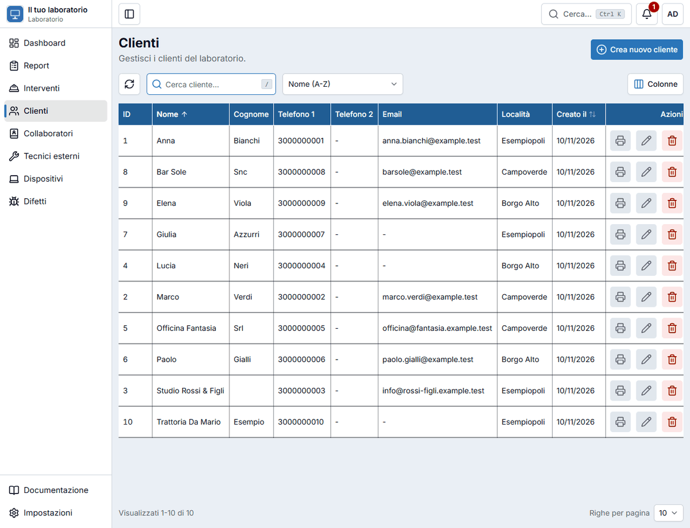
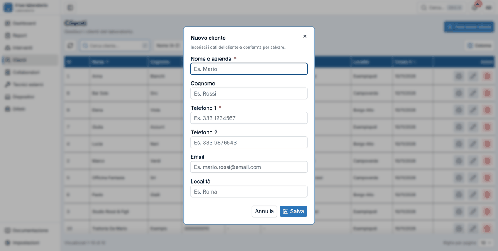
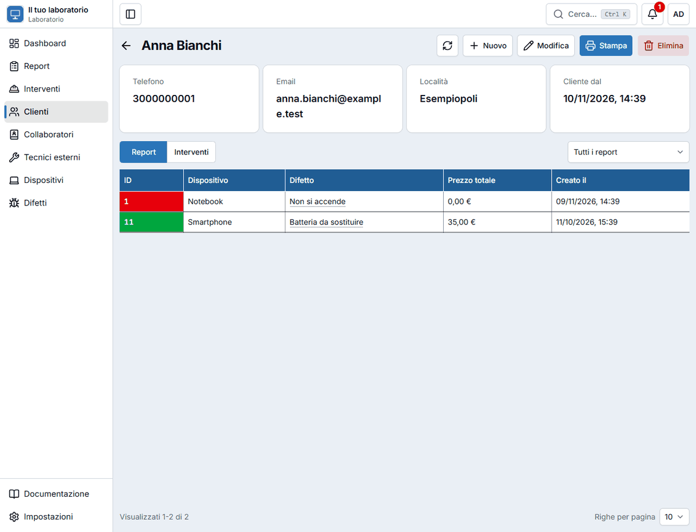
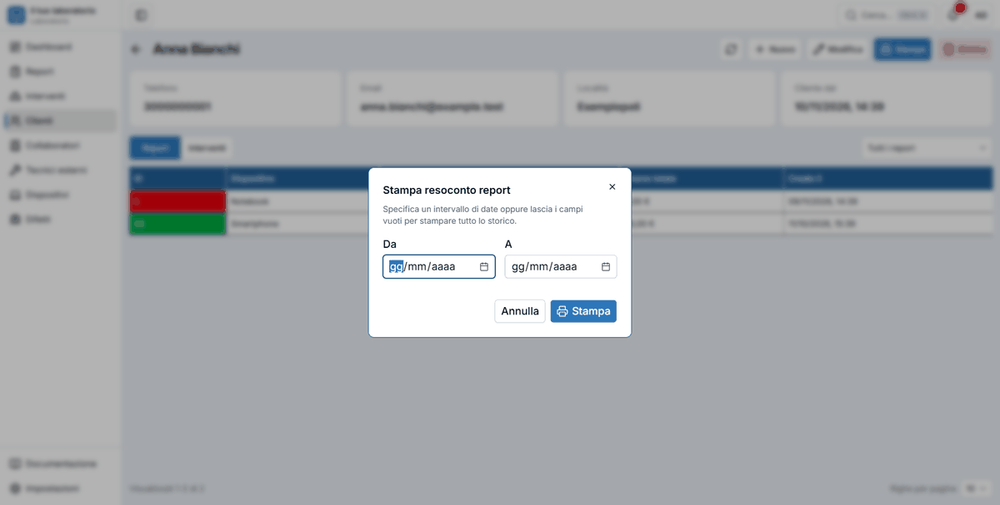

# Clienti

La pagina **Clienti** è l'anagrafica: ogni persona o azienda che ti porta un dispositivo o per cui fai un intervento. Da qui ritrovi tutta la loro storia.

L'elenco ha le colonne **Nome**, **Cognome**, **Telefono 1**, **Telefono 2**, **Email**, **Località** e la data di creazione. Per cercare, filtrare e ordinare vedi [Elenchi e filtri](elenchi.md). Nella ricerca dei clienti gli **accenti non contano**: «Nicolo» trova anche «Nicolò».

## Aggiungere un cliente

Il modo più comodo è dentro un [report](riparazioni.md) o un [intervento](interventi.md): premi il **+** accanto al campo **Cliente**. Si apre la finestra qui sotto e, quando salvi, il nuovo cliente è già selezionato. Dalla pagina Clienti usi **Crea nuovo cliente** (o ++n++).

| Campo | Note |
|---|---|
| **Nome o azienda** \* | Per un'azienda scrivi la ragione sociale qui e lascia vuoto il cognome. |
| **Cognome** | Facoltativo. |
| **Telefono 1** \* | Obbligatorio. |
| **Telefono 2** | Un secondo numero, se c'è. |
| **Email** | Serve per [inviargli gli interventi per email](stampe-email.md#inviare-un-intervento-per-email). |
| **Località** | La città. |

## La scheda del cliente

Cliccando il nome di un cliente (in qualunque elenco) si apre la sua scheda.

In alto trovi telefono, email, località e **Cliente dal** (la data di creazione). Sotto, due schede da scegliere:

- **Report**: tutti i suoi dispositivi, con un filtro per vedere solo gli aperti o i chiusi;
- **Interventi**: tutti i suoi lavori, con il filtro per stato.

I pulsanti in alto:

- **Nuovo** apre la finestra per creare un **report** o un **intervento** con **quel cliente già selezionato**;
- **Modifica** cambia i suoi dati;
- **Stampa** crea il **resoconto** del cliente (vedi sotto);
- **Elimina** cancella il cliente. Non si può se ha ancora report o interventi: prima vanno eliminati.

## Stampare il resoconto

Premendo **Stampa** si apre la finestra «Stampa resoconto report» (o «interventi», a seconda della scheda in cui sei).

Scegli un periodo con **Da** e **A**, oppure lascia vuoti i campi per stampare **tutto lo storico** (l'app ti chiede conferma). Premi **Stampa**: si apre un PDF con l'elenco dei report o degli interventi del cliente, pronto da stampare o salvare.

!!! note "Resoconti molto lunghi"
    Il resoconto non può superare **2000 righe**. Se ne hai di più, l'app ti chiede di scegliere un periodo più breve e stamparlo in più parti.
