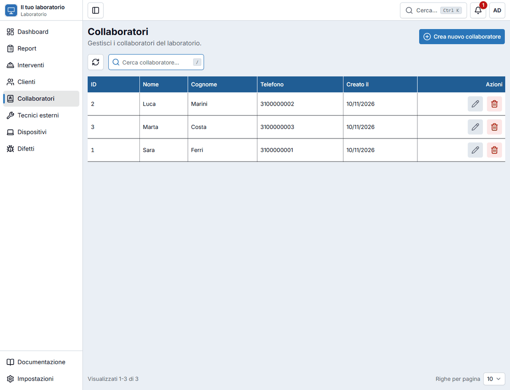
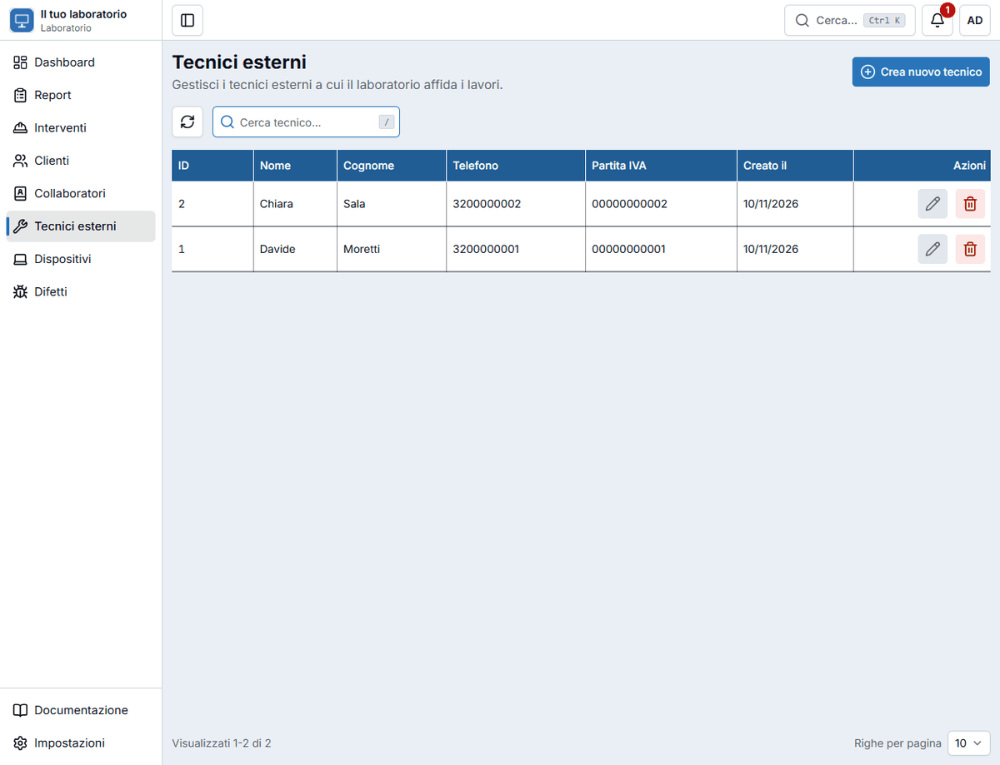

# Collaboratori e tecnici esterni

L'app distingue due tipi di persone che lavorano ai tuoi report e interventi.

| | Chi è | Dove compare |
|---|---|---|
| **Collaboratore** | Una persona **del laboratorio**, che segue e chiude i lavori. | Nel report e nell'intervento, campo **Collaboratore**. Per **chiudere un report** va indicato. |
| **Tecnico esterno** | Un professionista **esterno** a cui affidi un lavoro e che paghi a parte. | Nella finestra **Modifica report**, sezione **Tecnico esterno**, con il suo prezzo. |

## Collaboratori

Le colonne sono **Nome**, **Cognome**, **Telefono** e data di creazione. Per creare un collaboratore usa il pulsante di creazione in alto a destra (o ++n++) e scrivi almeno il nome. Con la **matita** correggi i dati, con il **cestino** elimini.

Cliccando un collaboratore si apre la sua **scheda**, con i report e gli interventi che ha seguito. Il pulsante **Stampa** crea il suo **resoconto** su un periodo a scelta, con la stessa finestra dei [clienti](clienti.md#stampare-il-resoconto): utile, per esempio, a fine mese.

!!! warning "Un collaboratore in uso non si elimina"
    Se è indicato in almeno un report o intervento, l'app non lo elimina. Se una persona lascia il laboratorio, lasciala nell'elenco: la sua storia resta leggibile.

## Tecnici esterni

Per ogni tecnico si registrano **Nome**, **Cognome**, **Telefono** e **Partita IVA**. La scheda del tecnico elenca i **report** che gli sono stati affidati, filtrabili per stato.

Per affidare un lavoro a un tecnico:

1. apri il report e premi **Modifica**;
2. nella sezione **Tecnico esterno** scegli il **Tecnico**;
3. scrivi il **Prezzo lavoro tecnico**, cioè quanto gli devi;
4. salva.

Il prezzo del tecnico compare nella scheda del report (**Prezzo tecnici**) e viene sommato nel **totale**. Nella finestra degli **incassi** della [dashboard](dashboard.md#gli-incassi-del-mese) lo stesso importo viene tolto nella riga «Al netto tecnici esterni».

!!! warning "Un tecnico assegnato a dei report non si elimina"
    Finché è collegato ad almeno un report, l'app non lo elimina.
