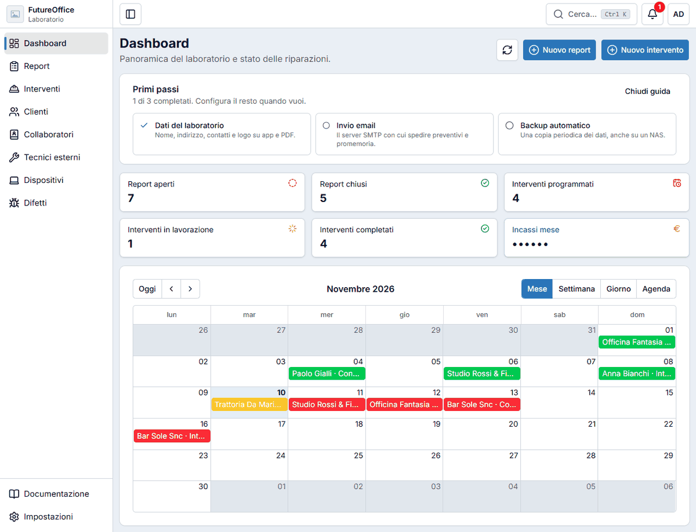
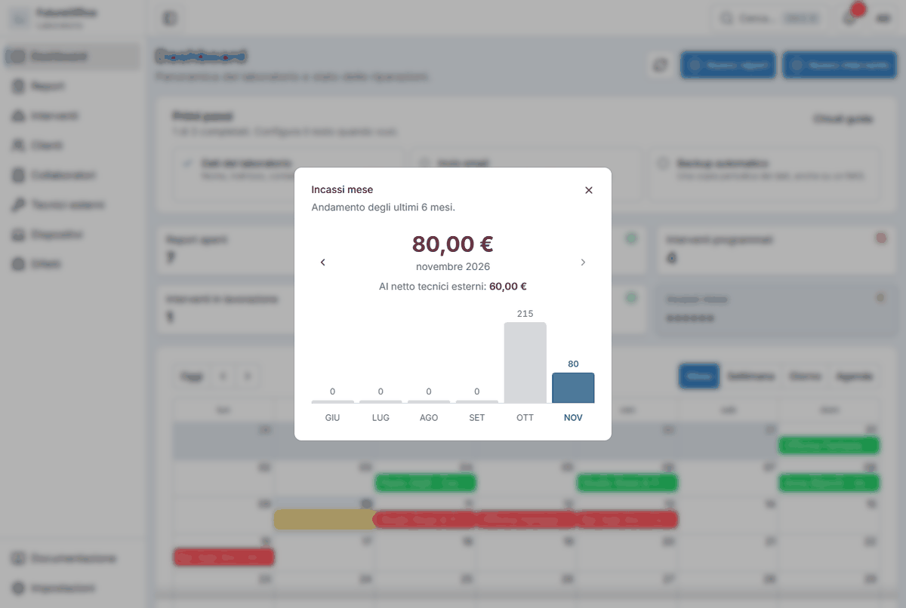
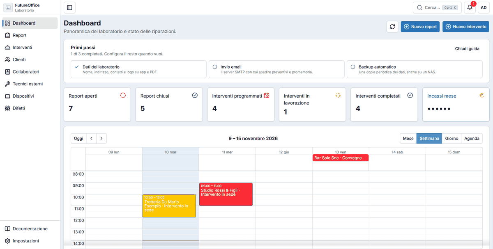
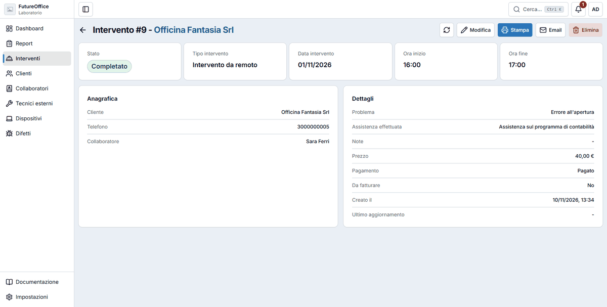
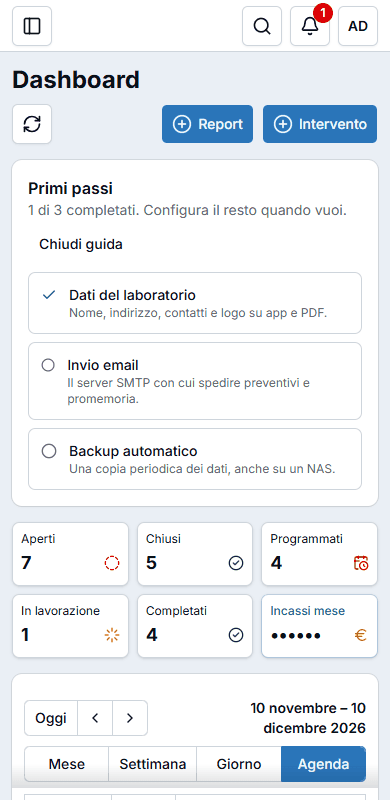

# Dashboard e calendario

La **Dashboard** è la prima pagina che vedi dopo l'accesso: ti dice a colpo d'occhio cosa c'è da fare.

## Creare al volo

In alto a destra ci sono due pulsanti per iniziare subito:

- **Nuovo report** per registrare un dispositivo appena arrivato (vedi [Report](riparazioni.md));
- **Nuovo intervento** per programmare o registrare un lavoro (vedi [Interventi](interventi.md)).

Il pulsante con le due frecce **ricarica** i numeri e il calendario. Con la tastiera puoi usare ++r++ e ++i++.

## I numeri

Le schede in alto contano:

| Scheda | Cosa conta |
|---|---|
| **Report aperti** / **chiusi** | I dispositivi ancora in laboratorio e quelli già consegnati. |
| **Interventi programmati** | I lavori da fare. |
| **Interventi in lavorazione** | I lavori iniziati e non ancora finiti. |
| **Interventi completati** | I lavori finiti. |
| **Incassi mese** | Gli incassi del mese (vedi sotto). |

**Ogni scheda è cliccabile**: ti porta all'elenco già filtrato. Per esempio, cliccando «Report aperti» vedi solo i report aperti.

### Gli incassi del mese

La scheda **Incassi mese** nasconde la cifra (al suo posto ci sono dei puntini), così non si legge passando. Cliccala per aprire la finestra con l'importo del mese, l'**andamento degli ultimi 6 mesi** e, sotto la cifra, quanto resta **al netto dei tecnici esterni**. Le frecce ‹ e › cambiano il mese.

## Il calendario degli interventi

Sotto i numeri c'è il calendario con tutti gli interventi. I colori sono quelli degli stati: **rosso** = programmato, **giallo** = in lavorazione, **verde** = completato.

- **Oggi**, **‹** e **›** cambiano il periodo visualizzato.
- **Mese**, **Settimana**, **Giorno** e **Agenda** cambiano la vista. L'app ricorda l'ultima che hai scelto.

Cosa puoi fare:

- **Passare il mouse** su un intervento mostra un riquadro con cliente, collaboratore, tipo, orario e descrizione.
- **Cliccare** un intervento apre la sua [scheda](interventi.md#la-scheda-dellintervento).
- **Fare doppio clic** su un giorno libero apre «Nuovo intervento» con quella **data già compilata**. Su telefono e tablet basta **tenere premuto** sul giorno.

## Primi passi (solo amministratore)

Finché il laboratorio non è del tutto configurato, l'amministratore vede in cima alla dashboard la scheda **Primi passi**, con tre cose da fare: **Dati del laboratorio**, **Invio email** e **Backup automatico**. Ogni voce porta alla sezione giusta delle [Impostazioni](impostazioni.md); quando hai finito, o non ti serve, premi **Chiudi guida**.

## Sul telefono

Le schede dei numeri si dispongono su tre colonne e il resto della pagina scorre verso il basso.

