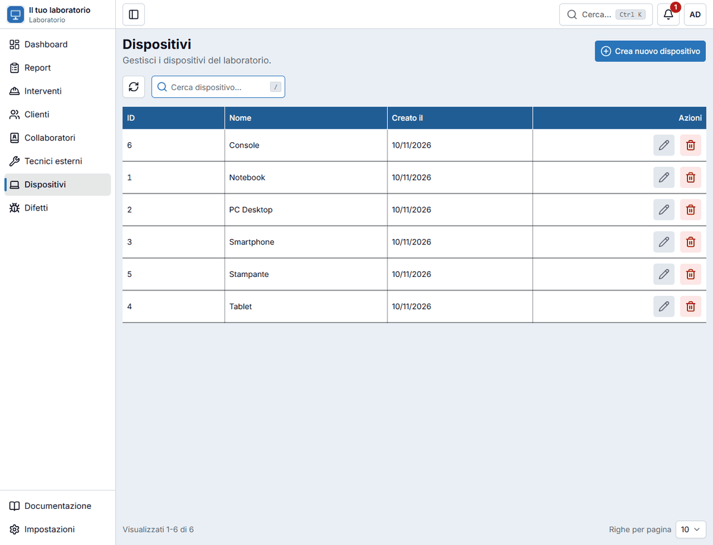
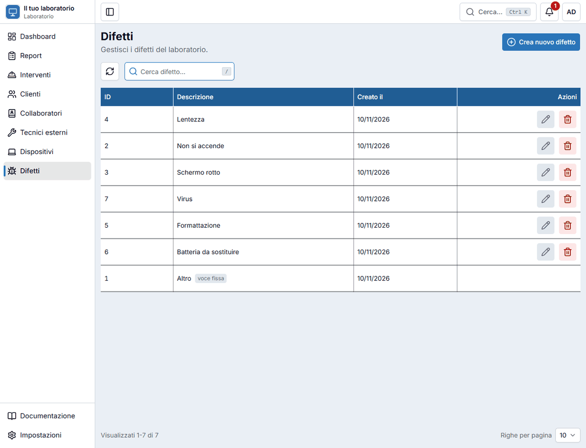

# Dispositivi e difetti

Due piccoli elenchi servono a compilare in fretta e in modo uniforme i [report](riparazioni.md):

- **Dispositivi**: i tipi di dispositivo che ti portano (Notebook, PC Desktop, Smartphone, Stampante…);
- **Difetti**: i problemi più comuni (Non si accende, Schermo rotto, Lentezza…).

Tenerli ordinati serve anche a **contare e cercare**: se scrivi «Notebook» sempre allo stesso modo, trovi tutti i notebook con una ricerca.

## Aggiungere un elemento

Hai due strade:

- **Mentre compili un report**: se il dispositivo o il difetto non è nell'elenco, premi il **+** accanto al campo, scrivi il nome e salva. È già selezionato.
- **Dalla pagina Dispositivi o Difetti**: premi il pulsante di creazione in alto a destra (o ++n++), scrivi il nome e salva.

Non si possono creare due elementi con lo stesso nome, anche se scritti con maiuscole diverse.

## Modificare ed eliminare

Con la **matita** correggi il nome; con il **cestino** lo elimini (dopo conferma).

!!! warning "Se è già usato, non si elimina"
    Un dispositivo o un difetto che compare in almeno un report non può essere eliminato: l'app lo dice e non cancella nulla. Correggere il nome è sempre possibile, e la correzione vale anche per i report già scritti.

## Il difetto «Altro»

Nell'elenco dei difetti c'è sempre la voce **Altro**, per tutto ciò che non ha un nome suo. Quando la scegli in un report, l'app ti chiede di descrivere il problema a parole.

