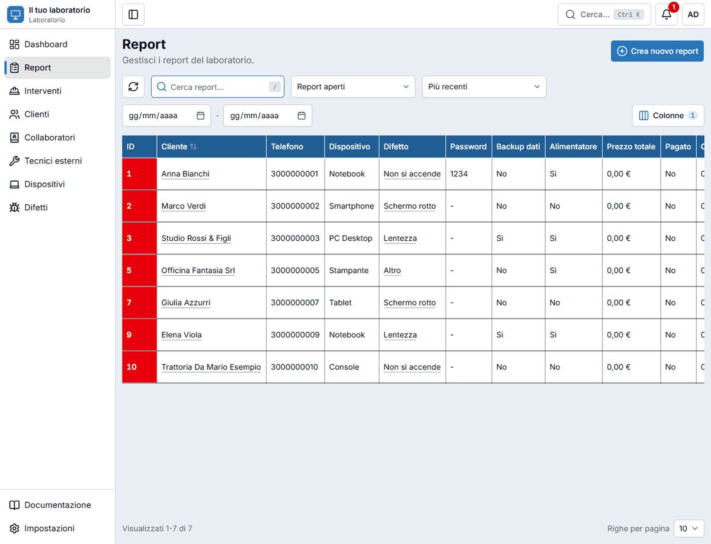
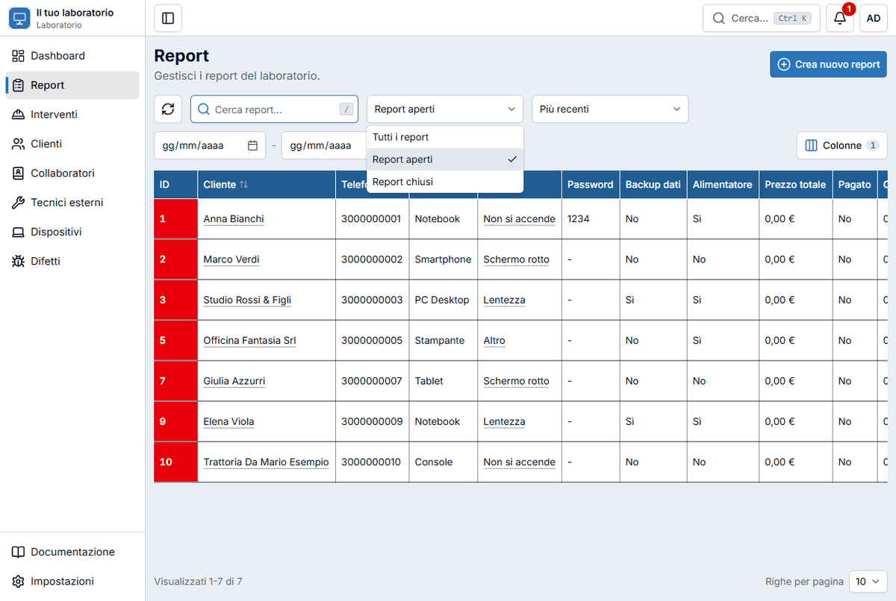
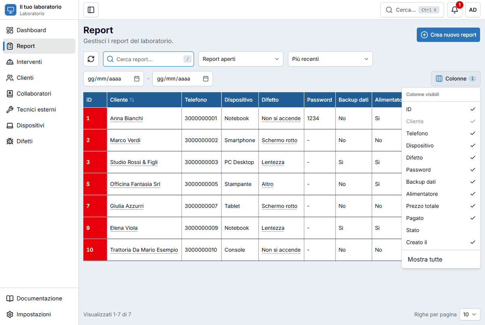
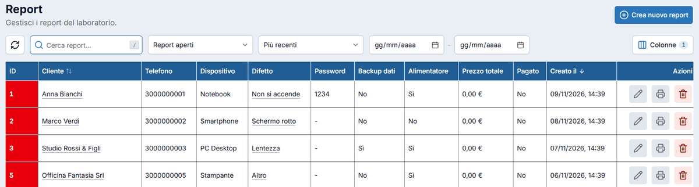

# Elenchi e filtri

Report, interventi, clienti, collaboratori, tecnici, dispositivi e difetti sono tutti elenchi fatti allo stesso modo: imparandone uno li sai usare tutti.

## Cercare

Scrivi nella casella **Cerca…** sopra la tabella: l'elenco si restringe mentre scrivi. Cerca in più campi insieme. Nei report, per esempio, trova il numero del report, il nome, il telefono o l'email del cliente, il dispositivo, il difetto, il collaboratore e i testi scritti nel report (note, password, descrizioni).

Per portarti subito nella casella premi ++slash++. Per svuotarla premi ++esc++.

## Filtrare e ordinare

Accanto alla ricerca trovi i filtri di quella pagina:

- il **filtro di stato**: nei report «Tutti i report», «Report aperti» (quello iniziale) e «Report chiusi»; negli interventi gli stati «Programmato», «In lavorazione», «Completato»;
- l'**ordinamento**: per esempio «Più recenti», «Meno recenti», «Cliente (A-Z)»;
- le due date **Dal** e **Al** per guardare solo un periodo.

Puoi anche **ordinare cliccando l'intestazione** di una colonna che ha le frecce ⇅ (per esempio **Cliente** o **Creato il**): un clic ordina in un verso, il successivo nel verso opposto.

!!! tip "Condividere una ricerca"
    Filtri, ordinamento e pagina sono scritti nell'**indirizzo** della pagina. Se copi l'indirizzo e lo mandi a un collega, vedrà esattamente la stessa lista.

## Scegliere le colonne

Il pulsante **Colonne** apre un menu con la spunta su ogni colonna: togli quelle che non ti servono (per esempio la password) o aggiungi quelle nascoste (come **Stato**). **Mostra tutte** le riaccende. La colonna del cliente non si può nascondere.

## Colori e dettagli

- Il **colore dell'ID** a sinistra di ogni riga dice lo stato: **rosso** = aperto o programmato, **giallo** = in lavorazione, **verde** = chiuso o completato.
- Il **nome del cliente** è un collegamento: cliccandolo si apre la sua scheda.
- Nei report, passando il mouse sul **difetto** compare la descrizione del problema.

## Le azioni di riga

A destra di ogni riga ci sono i pulsanti per **modificare** (matita), **stampare** (stampante) ed **eliminare** (cestino). Negli interventi c'è anche la **busta** per inviare l'email. Cliccando la riga (o l'ID) si apre la **scheda** con tutti i dettagli.

Prima di eliminare qualcosa l'app chiede conferma: nella finestra devi scrivere la parola **ELIMINA** e premere **Elimina**.

!!! warning "Un elemento in uso non si elimina"
    Non puoi eliminare un cliente, un collaboratore, un dispositivo o un difetto che è ancora collegato a dei report o interventi: l'app te lo dice e non cancella nulla. Per togliere un elemento prima devi eliminare o spostare ciò che lo usa.

## Pagine e righe per pagina

In fondo alla tabella vedi quante righe stai guardando («Visualizzati 1-7 di 7»), i numeri delle pagine e **Righe per pagina**: scegli quante ne vuoi vedere insieme. L'app si ricorda la scelta per ogni elenco.

## Aggiornare

Il pulsante con le due frecce a sinistra della ricerca **ricarica** l'elenco. Utile se più persone lavorano insieme e vuoi vedere subito le modifiche degli altri.
