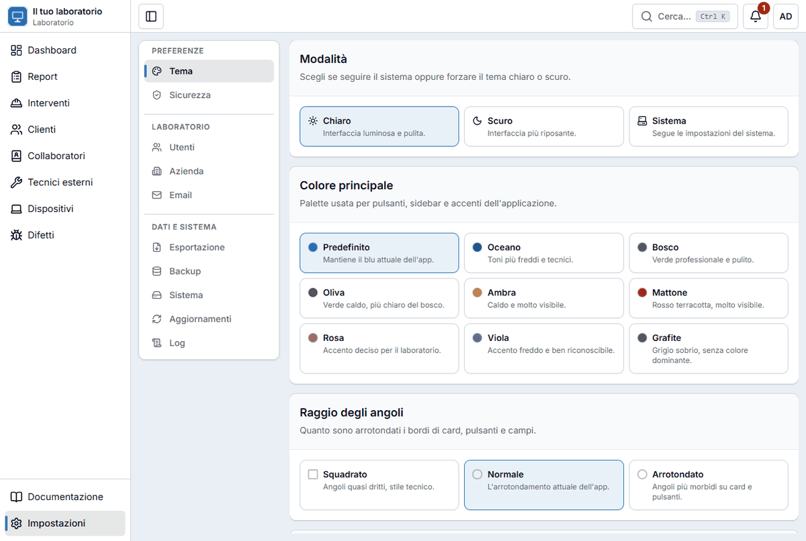
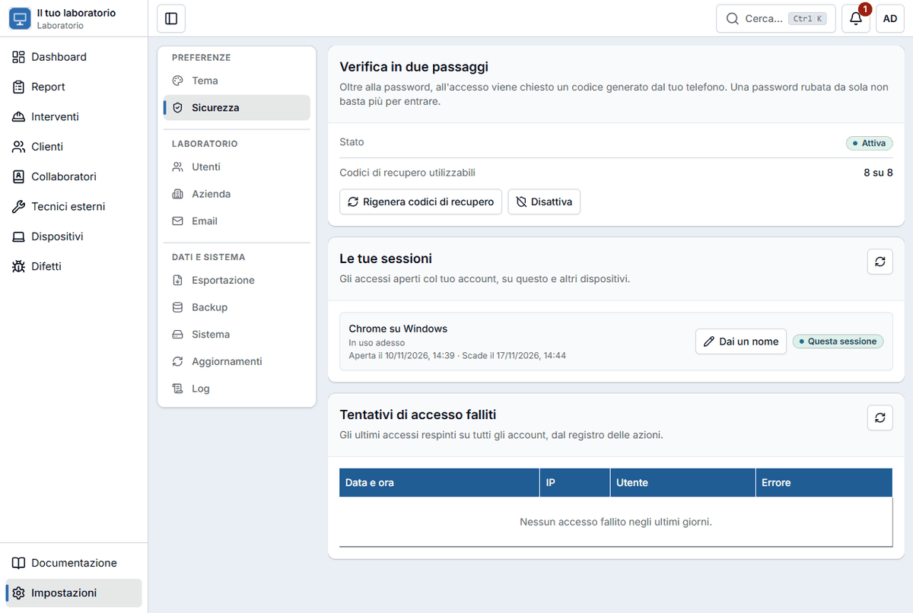
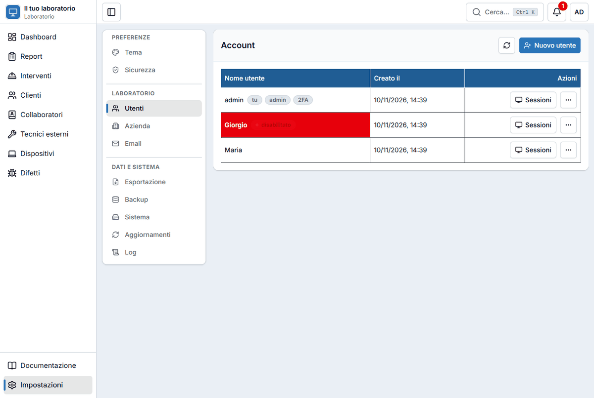
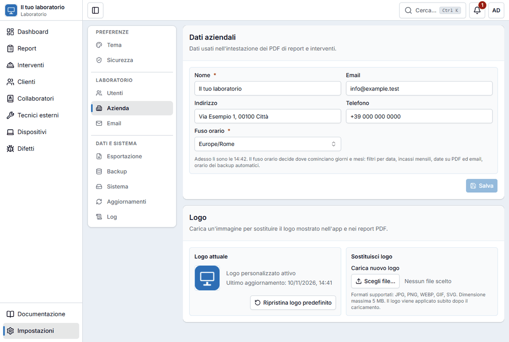
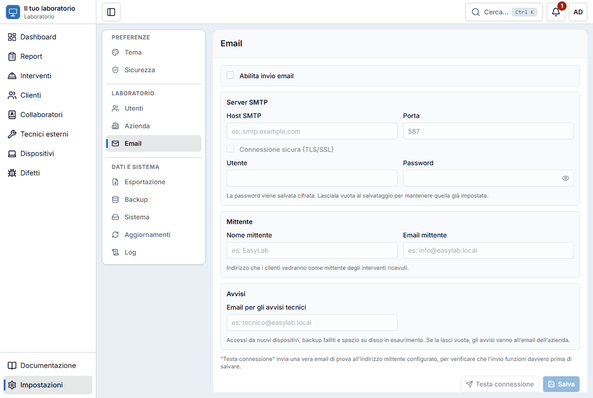
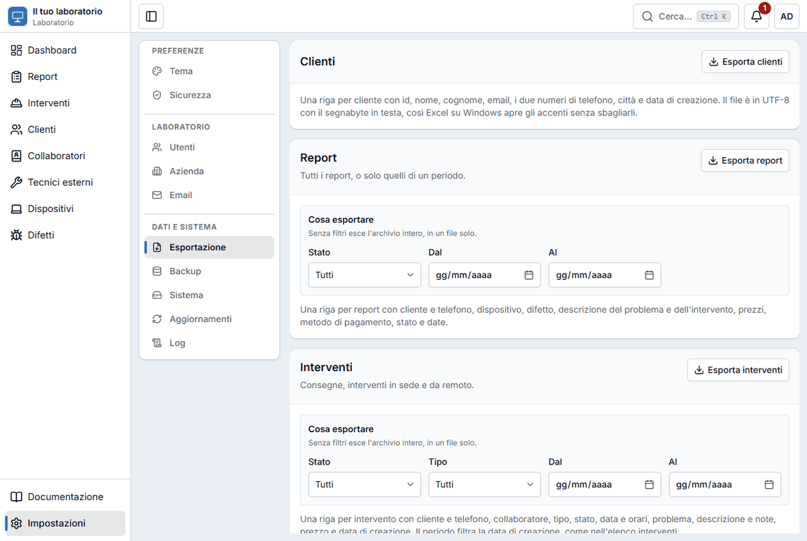
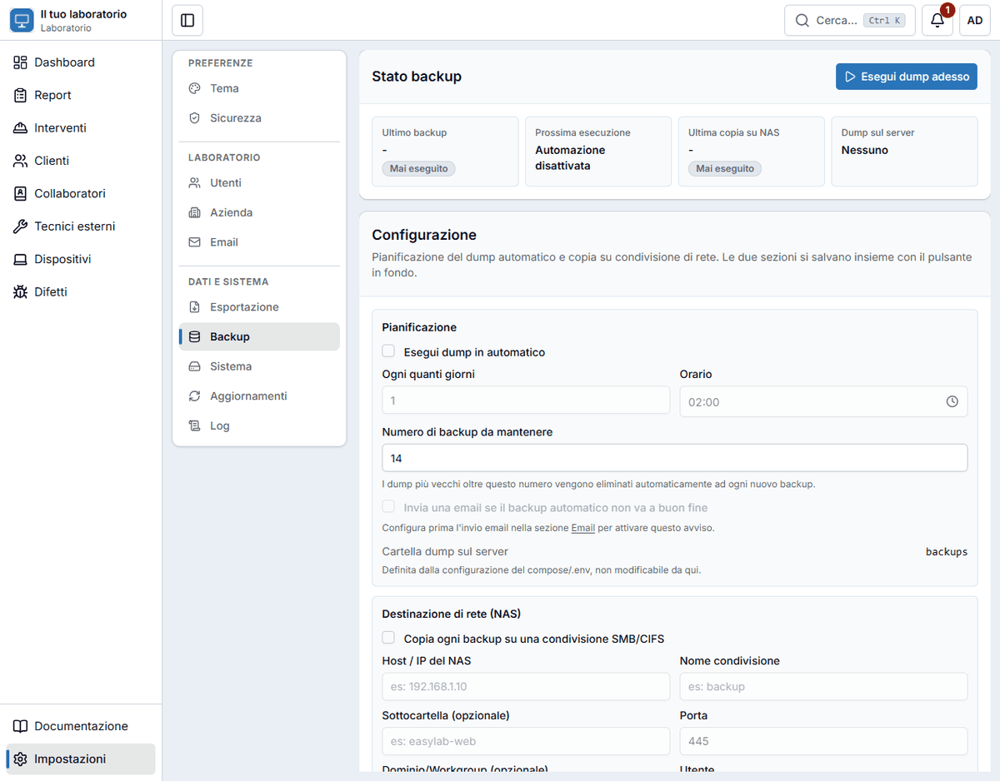
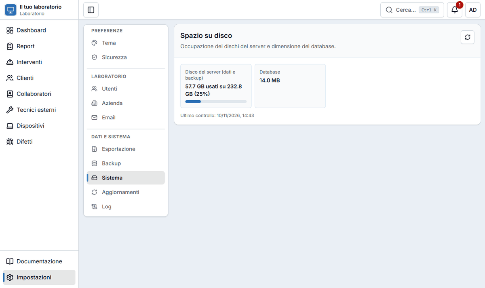
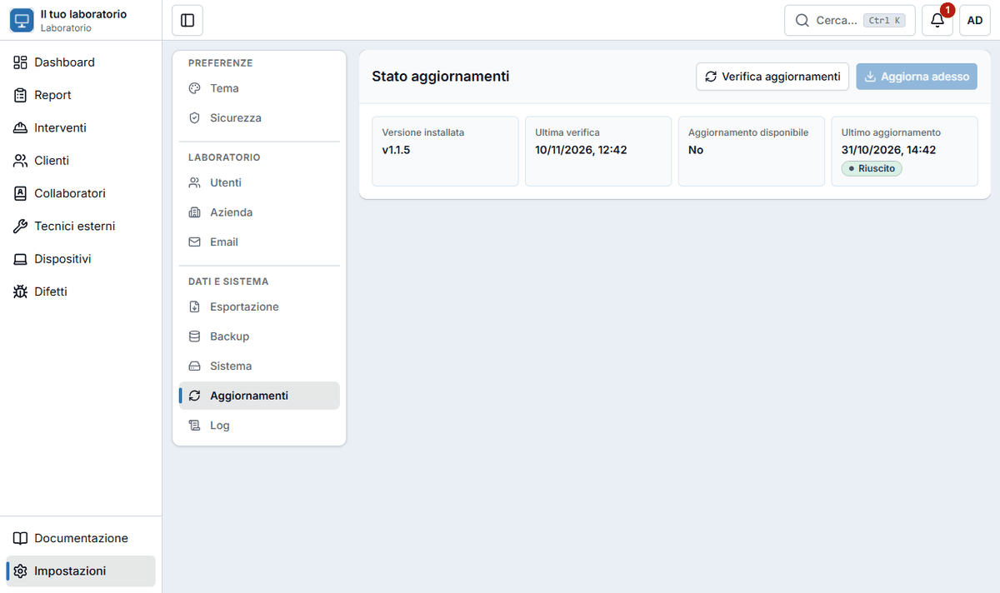
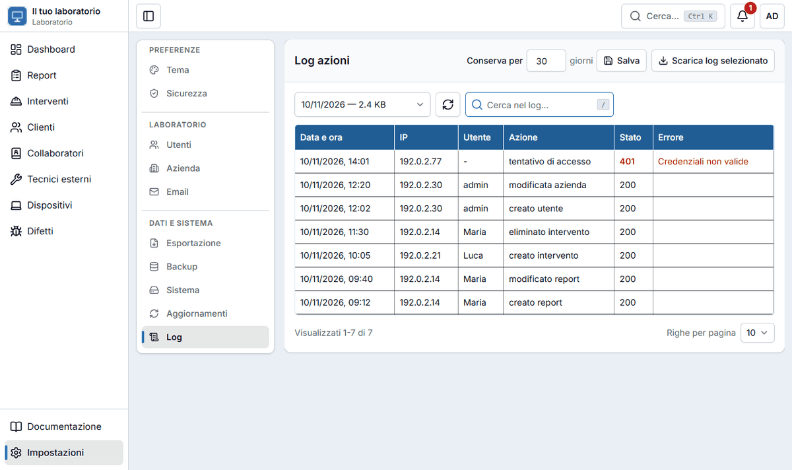

# Impostazioni

Le **Impostazioni** (in fondo al menu a sinistra) sono divise in tre gruppi: **Preferenze**, **Laboratorio** e **Dati e sistema**. A sinistra scegli la sezione, a destra vedi cosa contiene. Sul telefono la scelta è un menu a tendina in cima alla pagina.

Non tutti vedono tutto:

| Sezione | Chi la vede |
|---|---|
| **Tema**, **Sicurezza**, **Esportazione**, **Aggiornamenti** (sola lettura) | Tutti gli utenti |
| **Utenti**, **Azienda**, **Email**, **Backup**, **Sistema**, **Log** | Solo l'**amministratore** |

L'amministratore è l'account creato per primo, quello con il bollino **admin** nell'elenco utenti.

!!! info "Cerchi le istruzioni per il server?"
    Questa pagina spiega le impostazioni dentro l'app. Per installare, aggiornare o spostare il server, ripristinare un backup completo o gestire l'accesso da internet, vai alla **[Documentazione tecnica](../tecnica.md)**: [Deploy e configurazione server](../DEPLOY.md), [Backup, restore e migrazione](../BACKUP.md), [Sicurezza account e accesso](../OPERATIONS.md).

## Tema

Scegli **Modalità** (chiaro, scuro, oppure come il sistema), **Colore principale** (Predefinito, Oceano, Bosco, Oliva, Ambra, Mattone, Rosa, Viola o Grafite), **Raggio degli angoli** (squadrato, normale, arrotondato) e altri dettagli grafici. Qui puoi anche spegnere le [scorciatoie a un tasto](muoversi.md#le-scorciatoie-da-tastiera). La scelta resta salvata su quel computer.

## Sicurezza

Per tutti: attivare o disattivare la **verifica in due passaggi**, **rigenerare i codici di recupero**, vedere le **tue sessioni** e disconnetterne una. Vedi [Primo accesso](primo-accesso.md).

## Utenti

*(Amministratore)* L'elenco degli account che possono entrare nell'app.

- **Nuovo utente**: scrivi il nome utente. L'app genera una **password** e te la mostra **una volta sola**: copiala e consegnala alla persona. Alla prima entrata dovrà cambiarla.
- Accanto a ogni nome vedi dei bollini: **tu** (sei tu), **admin**, **2FA** (ha la verifica in due passaggi), **disabilitato**.
- **Sessioni** mostra dove quella persona è collegata.
- Il menu **…** di ogni utente permette di **rigenerare la password** (per chi l'ha dimenticata), **disabilitare** l'account senza cancellarlo, **disattivare la 2FA** (per chi ha perso telefono e codici) ed **eliminare** l'utente. Sul tuo stesso account non puoi rigenerare la password, disabilitarti o eliminarti: per cambiare la tua password usa **Cambia password** dal pulsante account.

!!! warning "Un utente che lascia il laboratorio"
    Meglio **disabilitarlo** che eliminarlo: l'accesso si chiude subito e resta traccia di cosa ha fatto nel [log](#log).

## Azienda

*(Amministratore)* I dati che compaiono nell'intestazione dei **PDF** e nelle email: **Nome**, **Email**, **Indirizzo**, **Telefono** e **Fuso orario**. Il fuso orario decide dove cominciano i giorni e i mesi (filtri per data, incassi mensili, date sui PDF, orario dei backup automatici), quindi controllalo.

Più sotto c'è il **Logo**: premi **Scegli file…** e carica un'immagine (JPG, PNG, WEBP, GIF o SVG, fino a 5 MB). Si applica subito all'app e ai PDF. **Ripristina logo predefinito** torna a quello di partenza.

## Email

*(Amministratore)* Serve per [inviare gli interventi ai clienti](stampe-email.md#inviare-un-intervento-per-email) e per ricevere gli avvisi del sistema. Per attivarla:

1. spunta **Abilita invio email**;
2. scrivi i dati del tuo provider di posta in **Server SMTP**: **Host**, **Porta**, **Connessione sicura (TLS/SSL)**, **Utente** e **Password** (te li dà chi gestisce la tua casella di posta);
3. in **Mittente** scrivi il **Nome** e l'**Email** che i clienti vedranno come mittente;
4. in **Avvisi** scrivi l'indirizzo che riceve gli **avvisi tecnici** (accessi da nuovi dispositivi, backup falliti, spazio su disco in esaurimento). Se lo lasci vuoto, vanno all'email dell'azienda;
5. premi **Testa connessione**: invia **una vera email di prova** all'indirizzo del mittente, così verifichi che l'invio funzioni prima di salvare;
6. premi **Salva**.

La password viene salvata **cifrata**. Se la lasci vuota nei salvataggi successivi, resta quella già impostata.

## Esportazione

Scarica i tuoi dati in file **CSV**, che si aprono con Excel: **Clienti**, **Report** e **Interventi**. Per report e interventi puoi restringere per **stato**, per **tipo** (interventi) e per **periodo** con **Dal** e **Al**; senza filtri esce l'archivio intero.

## Backup

*(Amministratore)* Una copia dei dati, per non perderli se il computer si rompe.

In alto vedi lo **Stato backup**: l'ultimo backup, la prossima esecuzione, l'ultima copia sul NAS e i backup presenti sul server. **Esegui dump adesso** fa subito un backup.

Nella **Configurazione**:

- **Pianificazione**: spunta **Esegui dump in automatico**, scegli **Ogni quanti giorni**, l'**Orario** e **Quanti backup mantenere** (i più vecchi vengono eliminati da soli). Puoi chiedere un'**email se il backup automatico non va a buon fine** (serve aver configurato l'[email](#email)).
- **Destinazione di rete (NAS)**: facoltativa. Copia ogni backup su una condivisione di rete (SMB/CIFS) indicando host, nome della condivisione, sottocartella, porta e credenziali.

Altre cose che trovi:

- **Chiave di cifratura dei backup**: i backup sono cifrati. Esporta la chiave **una volta** e **conservala altrove** (per esempio in un gestore di password): senza, un backup può diventare illeggibile se si perde anche il server.
- **Archivio dump**: l'elenco dei backup, con nome, data e dimensione.
- **Ripristino**: riporta i dati a un backup precedente, da un file già sul server o caricato da te. **Cancella i dati attuali**, quindi chiede di scrivere una parola di conferma e la tua password. Fallo solo se sai cosa stai facendo e, se puoi, chiedi prima a chi gestisce il server. Dettagli in [Backup, restore e migrazione](../BACKUP.md).

## Sistema

*(Amministratore)* Una scheda **Spazio su disco** con l'occupazione del **disco del server** (dati e backup), con una barra e i GB usati sul totale, e la **dimensione del database**. In fondo c'è l'ora dell'**ultimo controllo**; il pulsante con le due frecce lo ripete. Se il disco sta per riempirsi, l'app avvisa via email all'indirizzo degli [avvisi tecnici](#email).

## Aggiornamenti

Quattro riquadri: la **versione installata**, la data dell'**ultima verifica**, se c'è un **aggiornamento disponibile** (Sì o No) e la data dell'**ultimo aggiornamento**, con l'esito (**Riuscito**, oppure **Mai eseguito**). Tutti gli utenti li vedono; solo l'amministratore ha i pulsanti.

L'amministratore può premere **Verifica aggiornamenti** per controllare se esiste una versione nuova. Se c'è, **Aggiorna adesso** si attiva: l'app ricostruisce e riavvia i servizi, quindi per qualche istante **non è raggiungibile**. Conviene aggiornare quando nessuno sta lavorando, e dopo un backup.

Se la sezione dice che il servizio di aggiornamento non è configurato, l'aggiornamento si fa dal server: vedi [Deploy e configurazione server](../DEPLOY.md#aggiornamento-applicazione).

## Log

*(Amministratore)* Il **registro delle azioni**: chi ha fatto cosa e quando. Ogni riga ha **data e ora**, **IP** (l'indirizzo di rete da cui è partita la richiesta), **utente**, **azione** (per esempio «creato report» o «tentativo di accesso»), **stato** ed eventuale **errore**: gli accessi falliti compaiono con lo stato in rosso e il motivo.

- Il menu in alto a sinistra sceglie il **giorno** (ce n'è uno per giorno, con la dimensione del file); la casella **Cerca nel log…** filtra le righe.
- **Scarica log selezionato** salva il file del giorno scelto.
- **Conserva per … giorni** decide dopo quanto i registri vecchi vengono cancellati: cambia il numero e premi **Salva**.
