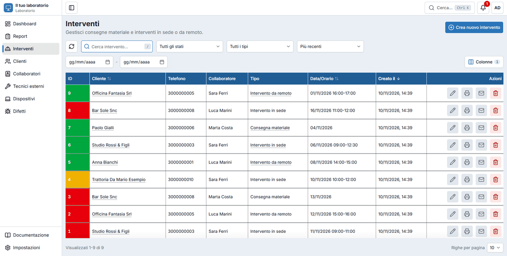
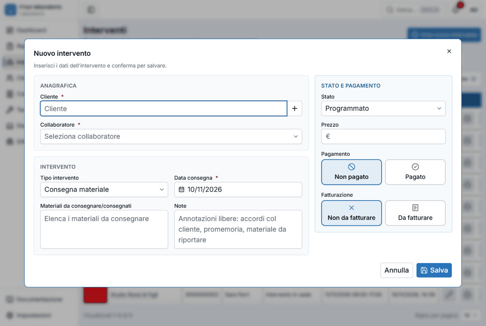
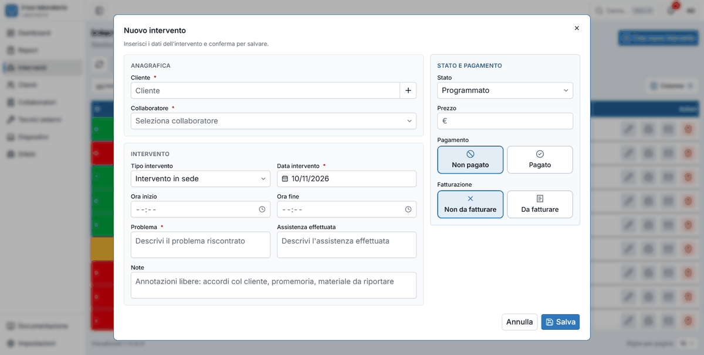
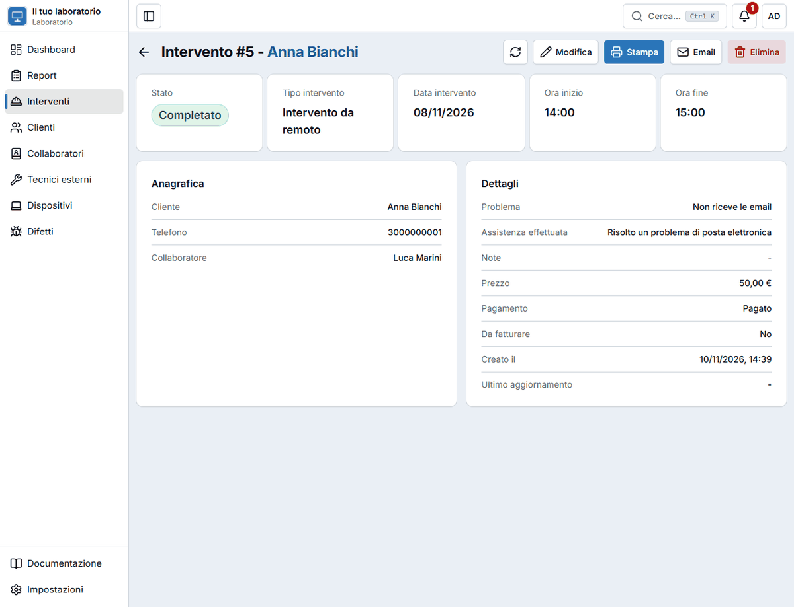

# Interventi

Un **intervento** è un lavoro che si programma o si registra, di solito fuori dal banco del laboratorio. Ne esistono tre tipi:

| Tipo | Quando si usa |
|---|---|
| **Intervento in sede** | Vai dal cliente a fare un lavoro. |
| **Intervento da remoto** | Fai assistenza a distanza. |
| **Consegna materiale** | Porti o consegni del materiale (cavi, alimentatori, un nuovo router…). |

Ogni intervento passa per tre **stati**: **Programmato** (da fare), **In lavorazione** (iniziato) e **Completato** (finito).

Il colore dell'ID dice lo stato: rosso = programmato, giallo = in lavorazione, verde = completato. Gli interventi di oggi compaiono anche nelle [notifiche](muoversi.md#le-notifiche) e nel [calendario](dashboard.md#il-calendario-degli-interventi).

## Creare un intervento

Premi **Crea nuovo intervento** nell'elenco o **Nuovo intervento** nella dashboard (oppure ++n++ / ++i++). Dal calendario puoi anche fare **doppio clic su un giorno**: la data è già compilata.

**Anagrafica**

- **Cliente**: scegli dall'elenco o aggiungilo con il **+**.
- **Collaboratore**: chi si occupa del lavoro. È obbligatorio.

**Intervento**

- **Tipo intervento**: uno dei tre di sopra. La finestra cambia a seconda della scelta.
- **Data intervento** (o **Data consegna** per il materiale).
- Per gli interventi in sede e da remoto compaiono **Ora inizio** e **Ora fine**, il **Problema** da risolvere (obbligatorio) e **Assistenza effettuata**.
- Per la consegna di materiale c'è invece **Materiali da consegnare/consegnati**: elenca cosa porti.
- **Note**: annotazioni libere (accordi col cliente, promemoria, materiale da riportare).

**Stato e pagamento**

- **Stato**: Programmato, In lavorazione o Completato.
- **Prezzo**: facoltativo.
- **Pagamento**: **Non pagato** o **Pagato**.
- **Fatturazione**: **Non da fatturare** (la scelta normale) o **Da fatturare**, se per quel lavoro va emessa fattura. Sono due cose diverse: «Da fatturare» non vuol dire che sia stato pagato.

!!! tip "Quando completare"
    Puoi salvare un intervento **Programmato** o **In lavorazione** anche senza orari e senza la descrizione del lavoro fatto: li scrivi alla fine. Quando lo passi a **Completato**, invece, serve la descrizione di cosa è stato fatto (**Assistenza effettuata**, o i materiali consegnati) e, per gli interventi in sede e da remoto, anche gli orari: un intervento chiuso deve dire cosa è stato fatto e quando.

## La scheda dell'intervento

Cliccando un intervento si apre la sua scheda.

In alto: **Stato**, **Tipo intervento**, **Data**, **Ora inizio** e **Ora fine**. Sotto, **Anagrafica** (cliente, telefono, collaboratore) e **Dettagli** (problema, assistenza effettuata, note, prezzo, pagamento, da fatturare, date).

I pulsanti in alto: **ricarica**, **Modifica**, **Stampa**, **Email** ed **Elimina**.

- **Modifica** riapre la finestra con tutti i campi, per cambiare stato, orari o importo.
- **Stampa** crea il modulo dell'intervento in PDF, con le firme (vedi [Stampe ed email](stampe-email.md)).
- **Email** lo spedisce al cliente.

## Eliminare un intervento

Come per i report: **Elimina** nella scheda o il **cestino** nell'elenco, poi scrivi la parola **ELIMINA** nella finestra di conferma.
