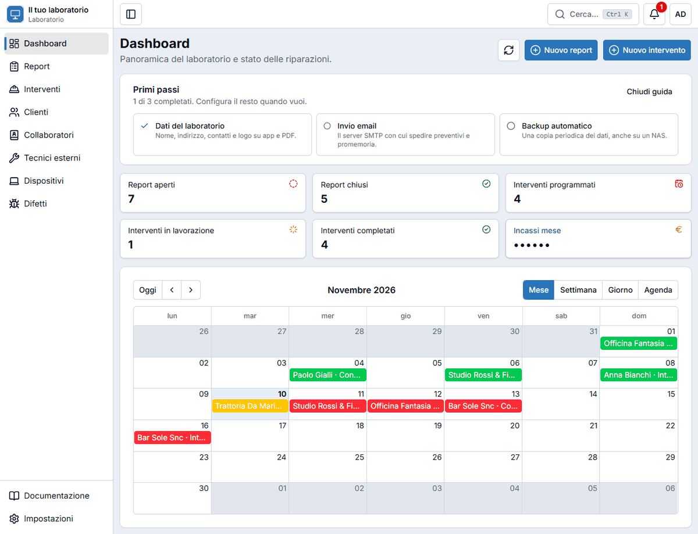
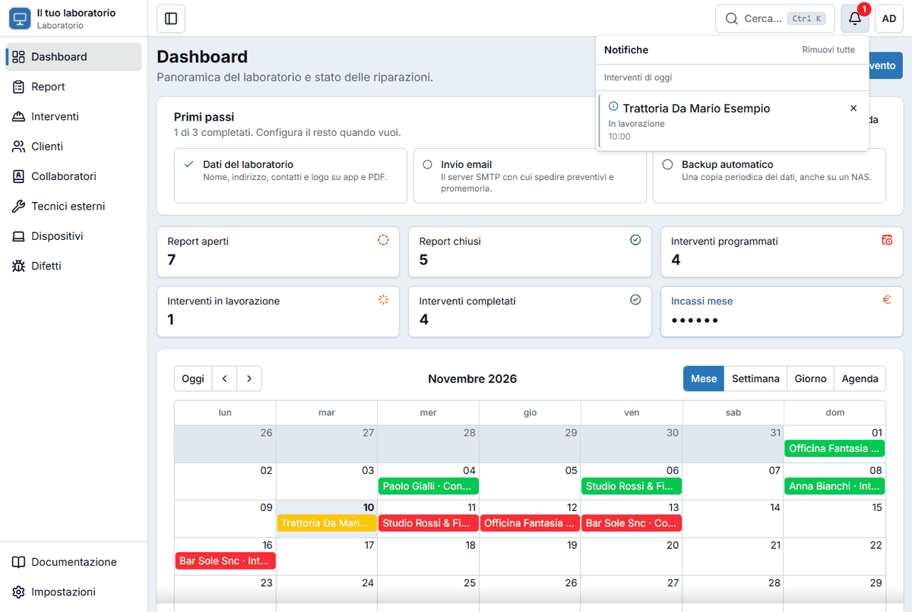
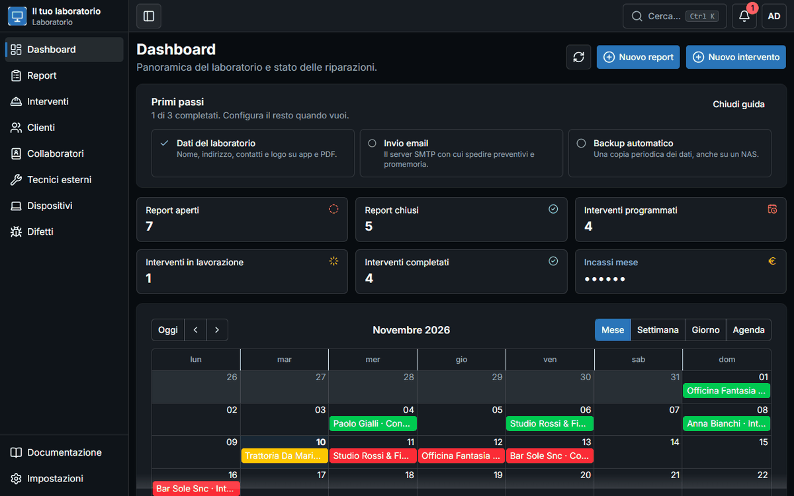
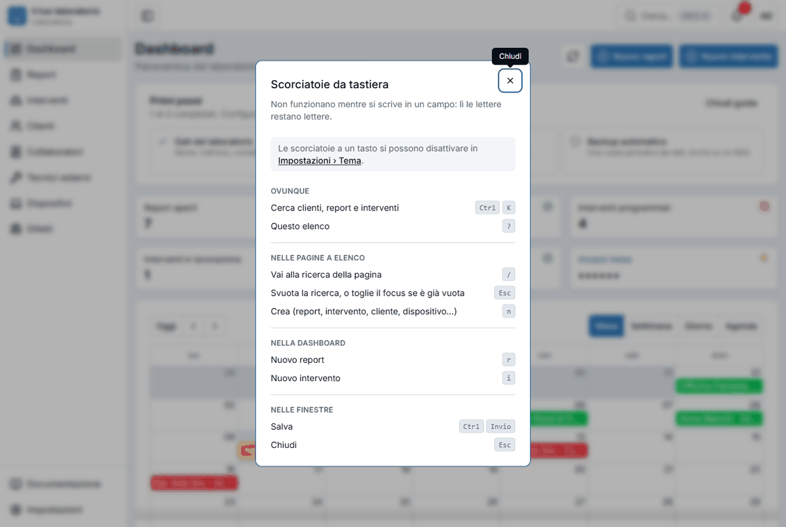
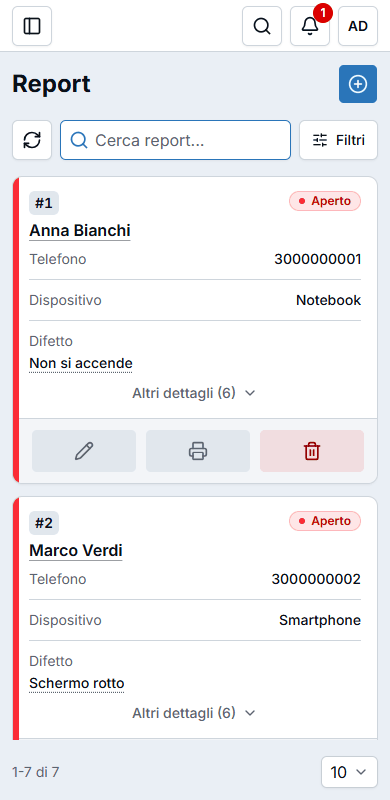

# Muoversi nell'app

## Il menu a sinistra

Il menu laterale ti porta a tutte le pagine:

| Voce | A cosa serve |
|---|---|
| **Dashboard** | La panoramica: i numeri del laboratorio e il calendario degli interventi. |
| **Report** | I dispositivi lasciati in laboratorio per una riparazione. |
| **Interventi** | I lavori da fare o fatti: in sede dal cliente, da remoto, consegne di materiale. |
| **Clienti** | L'anagrafica dei clienti e la loro storia. |
| **Collaboratori** | Le persone del laboratorio che seguono i lavori. |
| **Tecnici esterni** | I tecnici esterni a cui si affida un lavoro. |
| **Dispositivi** | L'elenco dei tipi di dispositivo (notebook, smartphone…). |
| **Difetti** | L'elenco dei difetti più comuni. |
| **Documentazione** | Apre questa guida. |
| **Impostazioni** | Tema, sicurezza, e per l'amministratore la gestione del laboratorio. |

Il pulsante con il quadrato in alto a sinistra **chiude o riapre** il menu per lasciare più spazio alla pagina. Sul telefono il menu compare sopra la pagina.

## La barra in alto

Da sinistra a destra:

- **Cerca…** apre la [ricerca su tutta l'app](ricerca.md) (scorciatoia: ++ctrl+k++).
- La **campanella** mostra le [notifiche](#le-notifiche).
- Il tuo **pulsante account** (le iniziali): **Cambia password**, **Esci** e, per l'amministratore, la gestione degli utenti.

## Le notifiche

La campanella ha un numero rosso quando c'è qualcosa da vedere. Aprendola trovi gli **interventi di oggi**, con cliente, stato e orario. Ogni voce si può chiudere con la **×**, oppure puoi usare **Rimuovi tutte**.

## Tema chiaro e scuro, colori

In **Impostazioni → Tema** scegli se l'app è **chiara**, **scura** o segue il **sistema** del computer, il **colore principale** (blu, verde, viola…), quanto sono **arrotondati** gli angoli e altro ancora. La scelta resta salvata su quel computer.

## Le scorciatoie da tastiera

Premi ++question++ da qualunque pagina per vedere l'elenco. Le principali:

| Tasto | Cosa fa |
|---|---|
| ++ctrl+k++ | Cerca clienti, report e interventi (su Mac ++cmd+k++) |
| ++question++ | Mostra l'elenco delle scorciatoie |
| ++slash++ | Va alla casella di ricerca della pagina |
| ++esc++ | Svuota la ricerca; chiude una finestra |
| ++n++ | Crea un nuovo elemento (report, intervento, cliente, dispositivo…) |
| ++r++ / ++i++ | Nella dashboard: nuovo **r**eport / nuovo **i**ntervento |
| ++ctrl+enter++ | Salva nella finestra aperta |

!!! note "Se le lettere ti danno fastidio"
    Le scorciatoie a un solo tasto non funzionano mentre scrivi in un campo. Se ti scattano per sbaglio, puoi spegnerle in **Impostazioni → Tema**.

## Sul telefono e sul tablet

L'app si adatta allo schermo: le tabelle diventano **schede** una sotto l'altra, e le finestre di creazione lunghe diventano **a passi** (con una barra «Passo 1 di 2» in alto).

