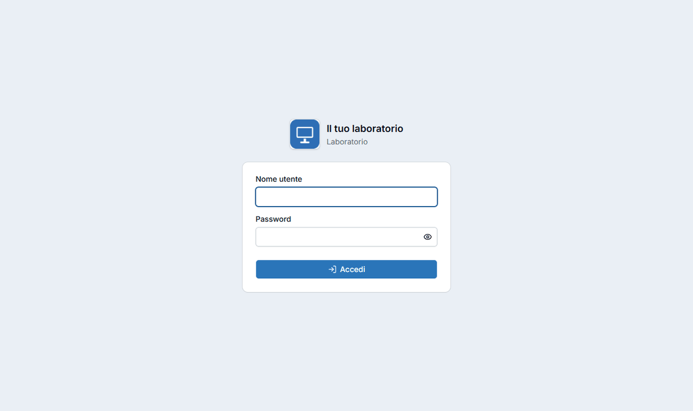
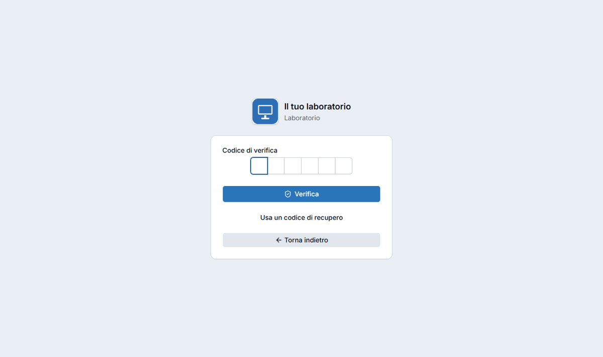
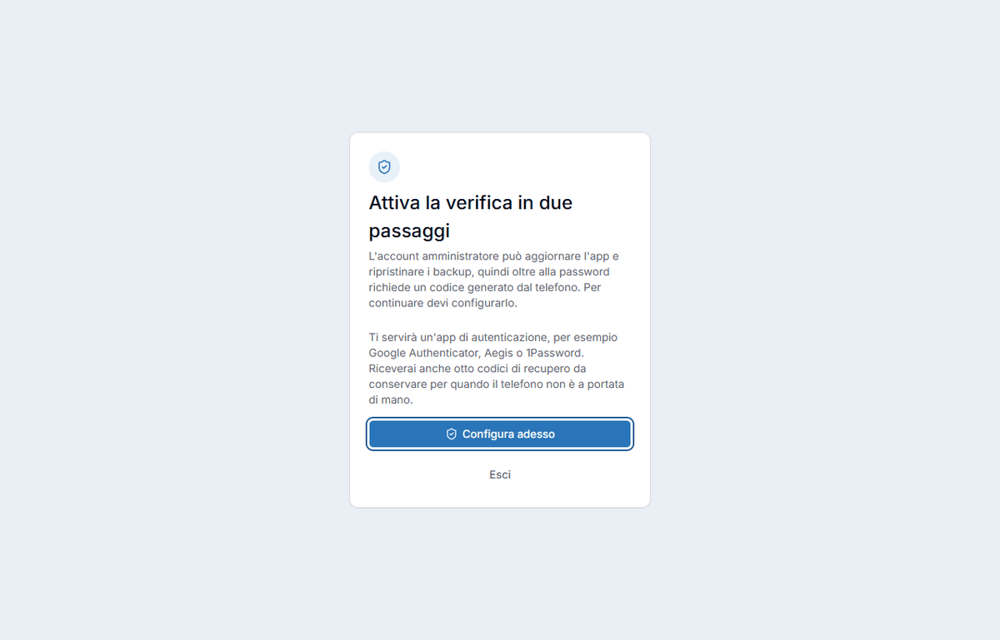
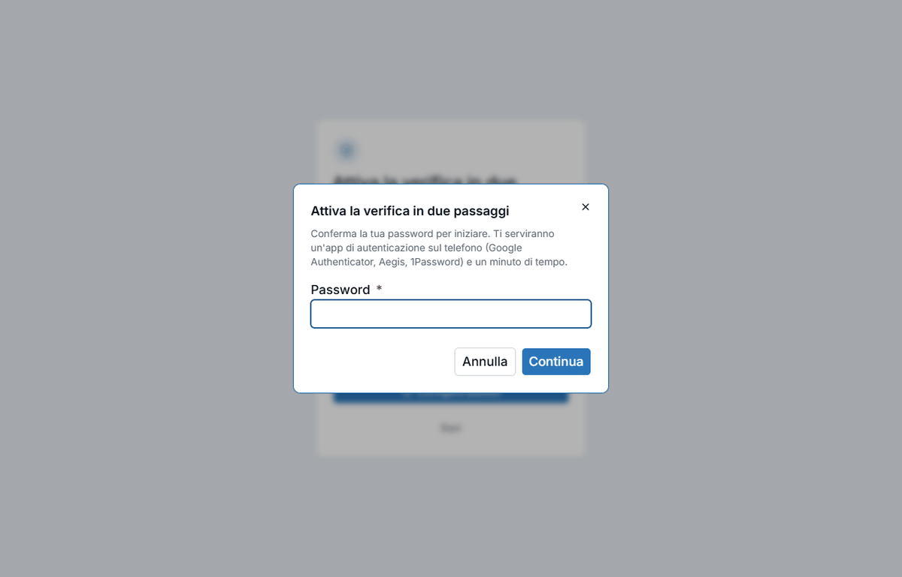
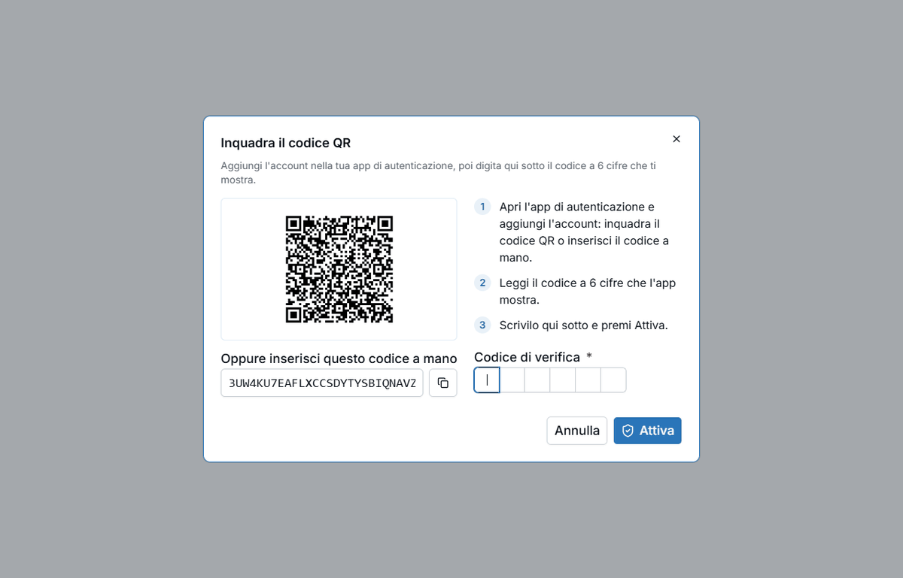
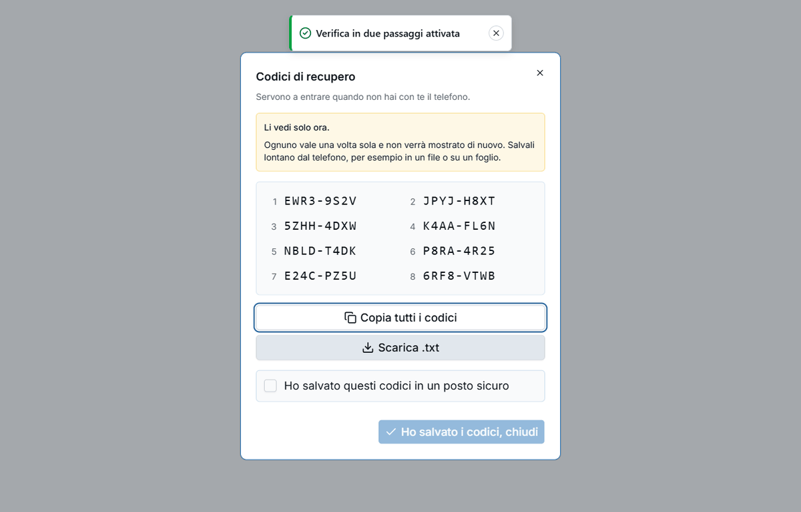
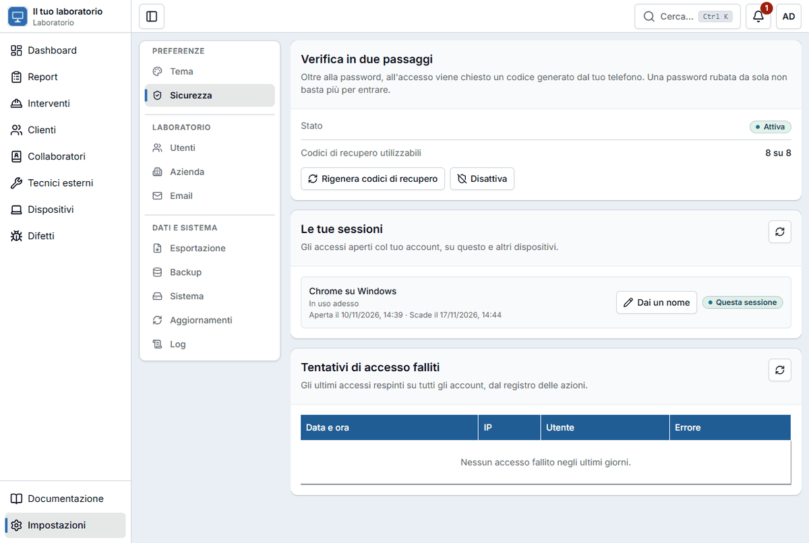

# Primo accesso

## Entrare

Apri l'indirizzo dell'applicazione che ti ha dato chi gestisce il server. Compare la pagina di accesso: scrivi il **nome utente** e la **password** e premi **Accedi**.

!!! note "Maiuscole nel nome utente"
    Il nome utente distingue le maiuscole dalle minuscole: se l'hanno creato come `Maria`, `maria` non funziona. Sul telefono la prima lettera si scrive in maiuscolo da sola.

Dopo qualche tentativo sbagliato l'app ti chiede di aspettare prima di riprovare: è una protezione, non un guasto.

Se resti collegato, l'accesso dura **7 giorni di inattività**: se non usi l'app per una settimana, dovrai rientrare.

## La verifica in due passaggi

L'account amministratore, oltre alla password, chiede un **codice a 6 cifre** che cambia ogni 30 secondi e si legge su un'app del telefono (per esempio Google Authenticator, Aegis o 1Password). Così una password rubata da sola non basta per entrare.

Dopo la password compare la richiesta del codice:

Scrivi il codice che vedi nell'app e premi **Verifica**. Se non hai il telefono, puoi usare uno degli otto **codici di recupero** (vedi sotto) con **Usa un codice di recupero**.

### Attivarla la prima volta (amministratore)

La prima volta che l'amministratore entra, l'app non lo lascia proseguire finché non ha attivato la verifica in due passaggi.

1. Premi **Configura adesso**.
2. Scrivi la tua password per confermare.

    

3. Apri l'app di autenticazione sul telefono e aggiungi un account **inquadrando il codice QR**. Se non puoi inquadrarlo, scrivi a mano il codice sotto l'immagine, oppure copialo con il pulsante accanto.
4. Scrivi nella finestra il codice a 6 cifre che l'app ti mostra e premi **Attiva**.

    

5. L'app ti mostra otto **codici di recupero**. **Li vedi una volta sola.** Salvali lontano dal telefono, per esempio in un file o su un foglio: servono quando il telefono è perso o rotto. Ognuno vale una volta sola.

    

6. Spunta **Ho salvato questi codici in un posto sicuro** e chiudi.

!!! warning "Se perdi telefono e codici di recupero"
    Da solo non puoi rientrare: serve intervenire sul server. Chi lo gestisce trova la procedura in [Sicurezza account e accesso](../OPERATIONS.md).

## Cambiare la tua password

Premi il tuo **pulsante account** (le iniziali, in alto a destra) e scegli **Cambia password**. Ti viene chiesta la password attuale e quella nuova.

La nuova password deve avere **almeno 8 caratteri**, **un numero** e **un carattere speciale** (come `!`, `?`, `#`, `@`).

Se un amministratore ti ha creato l'account o ha rigenerato la tua password, la prima volta che entri l'app ti chiede di sceglierne una tua.

## Vedere dove sei collegato

In **Impostazioni → Sicurezza** trovi l'elenco delle tue **sessioni**, cioè dei dispositivi su cui hai fatto l'accesso, e, se sei amministratore, gli ultimi **tentativi di accesso falliti** su tutti gli account. Puoi dare un nome a un dispositivo (per esempio «Portatile del banco») per riconoscerlo, e disconnettere una sessione che non è più tua.

## Uscire

Premi il tuo pulsante account in alto a destra e scegli **Esci**. Su un computer condiviso esci sempre a fine lavoro.
