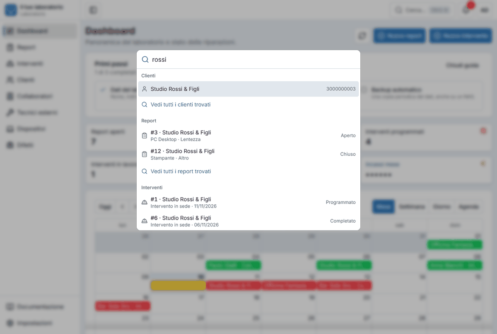

# Cerca ovunque

La ricerca in alto trova **clienti**, **report** e **interventi** senza dover prima scegliere la pagina giusta.

## Come si usa

1. Premi ++ctrl+k++ (su Mac ++cmd+k++) oppure clicca **Cerca…** nella barra in alto.
2. Scrivi quello che sai: un nome, un numero di telefono, il numero di un report.
3. Scegli un risultato con il mouse o con le frecce ++arrow-up++ e ++arrow-down++, e premi ++enter++. Si apre la scheda.
4. ++esc++ chiude la ricerca.

I risultati sono raggruppati:

- **Clienti**: con il numero di telefono accanto;
- **Report**: numero, cliente, dispositivo e difetto, e a destra lo stato (Aperto o Chiuso);
- **Interventi**: numero, cliente, tipo, data e stato.

Sotto ogni gruppo, **Vedi tutti i … trovati** apre l'elenco completo con la ricerca già scritta, utile quando i risultati sono più di quelli mostrati.

## Trucchi

- Scrivere solo il **numero** di un report o di un intervento (per esempio `12`) porta dritto a quello.
- Nella ricerca dei clienti gli **accenti non contano**: «Nicolo» trova anche «Nicolò».
- Puoi anche scrivere il nome di una **pagina** (per esempio «impostazioni» o «difetti») per andarci subito.
- Dentro un elenco, ++slash++ porta alla casella di ricerca di quella pagina: lì la ricerca restringe l'elenco che stai guardando. Vedi [Elenchi e filtri](elenchi.md).
