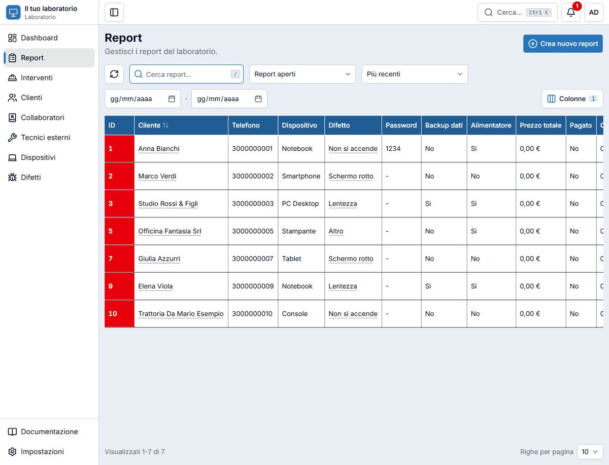
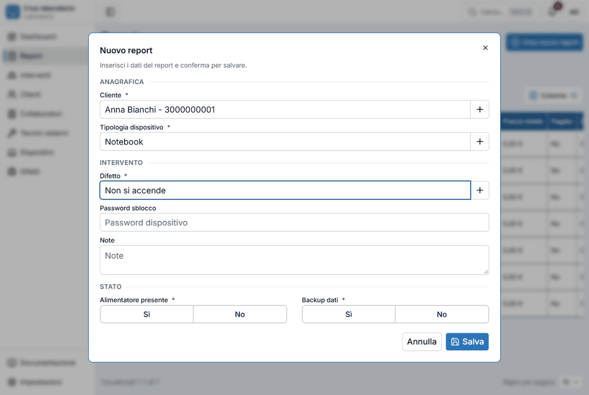
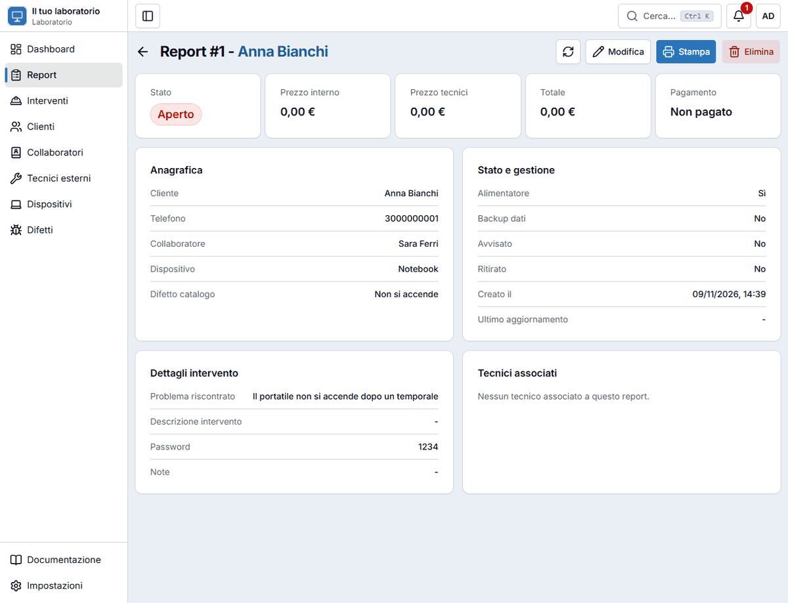
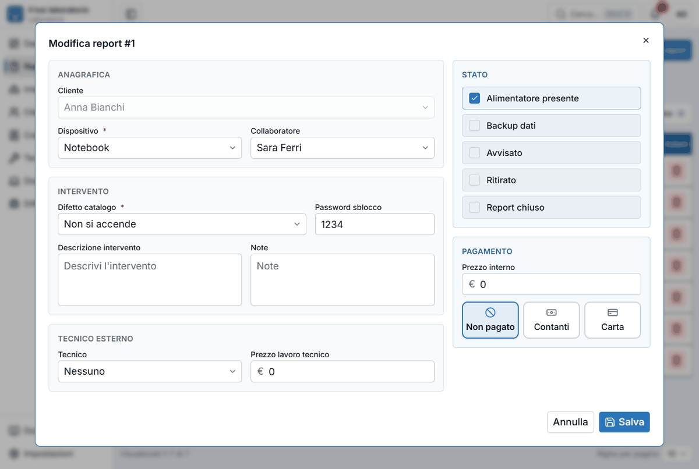
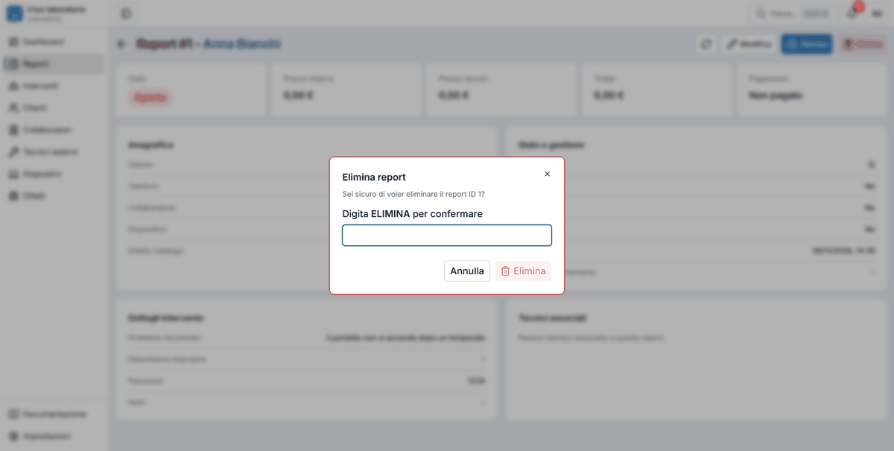
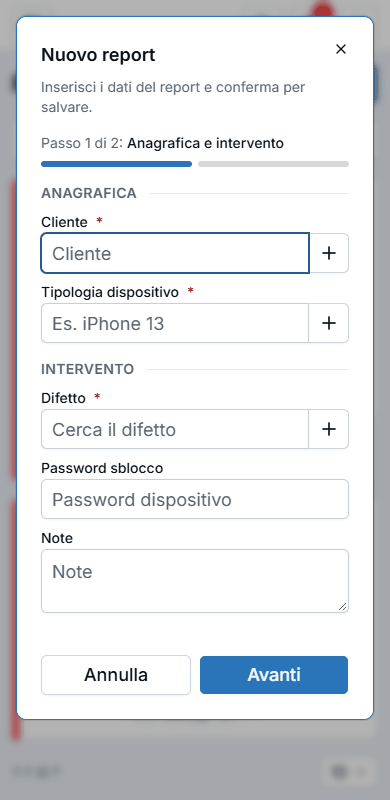

# Report

Un **report** è la scheda di un dispositivo lasciato in laboratorio per una riparazione: chi l'ha portato, che dispositivo è, che difetto ha, se c'era l'alimentatore, se serve fare il backup dei dati. Resta **aperto** finché il lavoro non è finito e il dispositivo non è stato riconsegnato; poi si **chiude**.

L'elenco mostra di default i **report aperti**. Per vedere quelli già chiusi cambia il filtro in «Report chiusi» o «Tutti i report» (vedi [Elenchi e filtri](elenchi.md)).

## Creare un report

Premi **Crea nuovo report** (in alto a destra) oppure, nell'elenco, ++n++. Dalla dashboard c'è anche **Nuovo report**.

I campi con l'asterisco rosso **\*** sono obbligatori.

**Anagrafica**

- **Cliente**: comincia a scrivere il nome o il telefono e scegli dall'elenco. Se il cliente non esiste, premi il **+** accanto al campo: si apre la finestra per crearlo, e al ritorno è già selezionato.
- **Tipologia dispositivo**: come sopra. Se il tipo non c'è (per esempio «Console»), il **+** lo aggiunge.

**Intervento**

- **Difetto**: scegli il difetto dall'elenco, o aggiungilo con il **+**. Se scegli **Altro** compare la casella **Problema riscontrato**, che diventa obbligatoria: descrivi a parole cosa non va.
- **Password sblocco**: la password del dispositivo, se il cliente te l'ha data. Nell'elenco dei report è visibile: usala con attenzione.
- **Note**: qualunque cosa utile (accordi presi, graffi già presenti…).

**Stato**

- **Alimentatore presente** e **Backup dati**: rispondi **Sì** o **No** a tutte e due.

Premi **Salva** (oppure ++ctrl+enter++). Il report compare in cima all'elenco, aperto.

## La scheda del report

Cliccando un report si apre la sua scheda.

In alto vedi lo **stato** (Aperto o Chiuso), il **prezzo interno** (quello del laboratorio), il **prezzo dei tecnici** esterni, il **totale** e il **pagamento**. Sotto, le sezioni:

- **Anagrafica**: cliente, telefono, collaboratore, dispositivo e difetto.
- **Stato e gestione**: alimentatore, backup dati, **Avvisato** (il cliente è stato contattato, in qualunque modo) e **Ritirato** (il dispositivo è stato ritirato dal cliente), e le date di creazione e di ultimo aggiornamento.
- **Dettagli intervento**: il problema riscontrato, la descrizione di cosa hai fatto, la password e le note.
- **Tecnici associati**: l'eventuale tecnico esterno e quanto costa.

I pulsanti in alto: **ricarica**, **Modifica**, **Stampa** (vedi [Stampe ed email](stampe-email.md)) ed **Elimina**.

## Modificare un report e chiuderlo

Premi **Modifica** (dalla scheda) o la **matita** nell'elenco. Si apre la finestra completa.

Man mano che il lavoro va avanti la aggiorni:

- scrivi nella **Descrizione intervento** cosa hai fatto;
- spunta **Avvisato** quando hai contattato il cliente (per telefono o in qualunque altro modo), e **Ritirato** quando il cliente ha ritirato il dispositivo. Sono due spunte a sé: non chiudono il report da sole, che si chiude solo con **Report chiuso**;
- se il lavoro è stato affidato a un tecnico esterno, scegli il **Tecnico** e scrivi il **Prezzo lavoro tecnico**;
- scrivi il **Prezzo interno** e scegli il **pagamento**: **Non pagato**, **Contanti** o **Carta**;
- quando tutto è finito, spunta **Report chiuso**.

!!! warning "Regole da conoscere"
    - Per **chiudere** un report serve indicare il **Collaboratore** che l'ha seguito.
    - Se segni il pagamento in **Contanti** o con **Carta**, il **prezzo** deve essere maggiore di zero.
    - Il **cliente** di un report esistente non si cambia (il campo è bloccato). Se hai sbagliato cliente, elimina il report e creane uno nuovo.

## Eliminare un report

Premi **Elimina** nella scheda o il **cestino** nell'elenco. Nella finestra di conferma devi scrivere la parola **ELIMINA** e premere **Elimina**: l'eliminazione non si può annullare.

## Il report sul telefono

Sul telefono la finestra Nuovo report è **a passi**: prima l'anagrafica e l'intervento («Passo 1 di 2»), poi lo stato.

