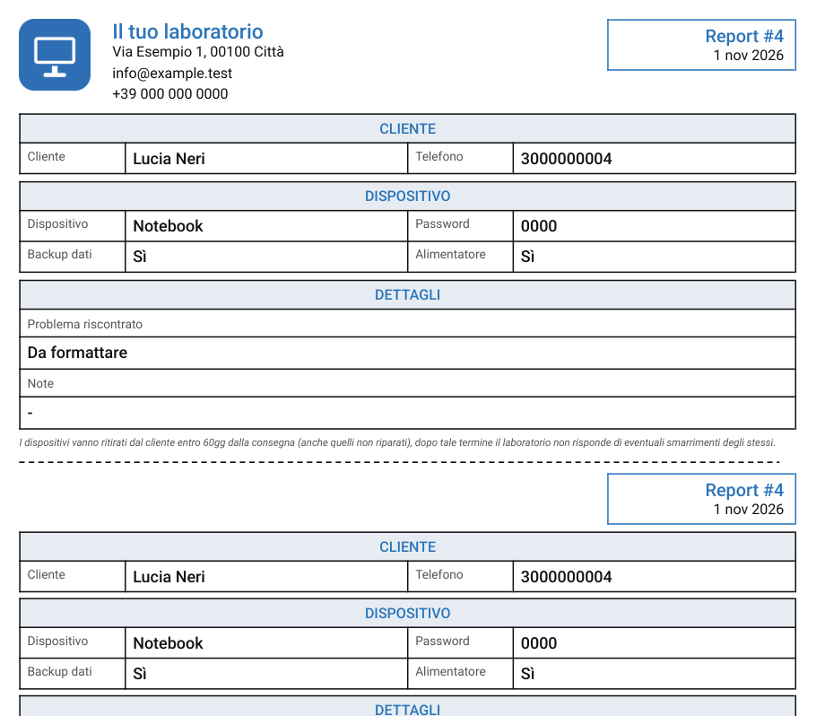
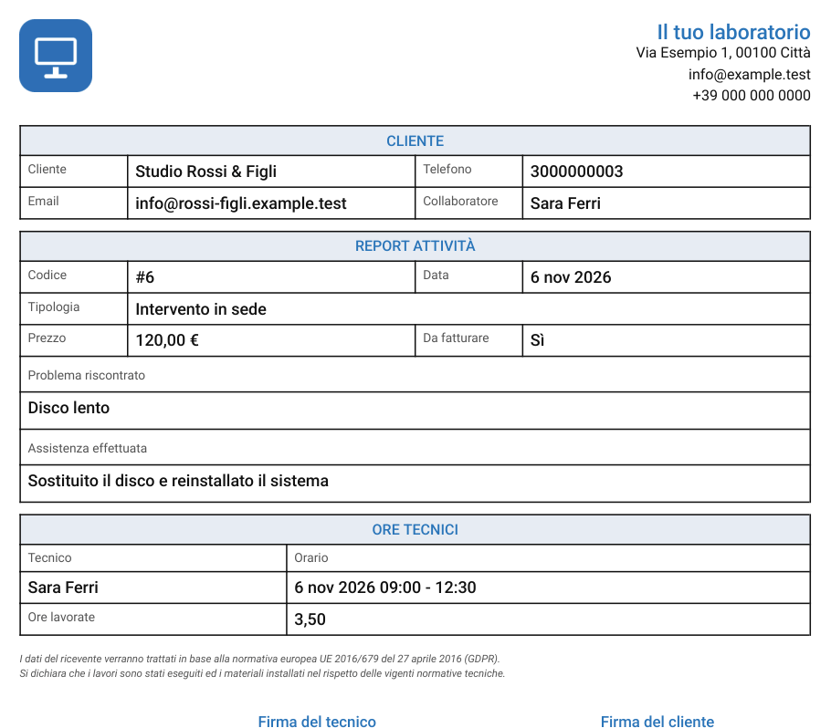
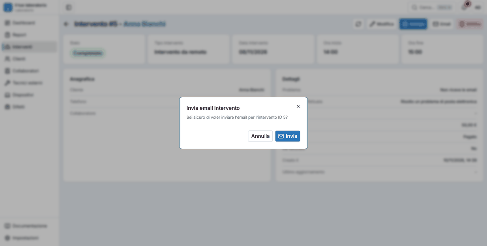

# Stampe ed email

L'app prepara dei **moduli in PDF** con l'intestazione del laboratorio (nome, indirizzo, email, telefono e logo, che l'amministratore imposta in [Impostazioni → Azienda](impostazioni.md#azienda)). Un PDF si può stampare, salvare o inviare.

## Stampare un report

Nell'elenco dei report premi la **stampante** sulla riga, oppure **Stampa** nella scheda del report. Il PDF si apre in una nuova finestra: stampalo dal visualizzatore o salvalo.

Contiene i dati del **cliente**, del **dispositivo** (con password, backup dati e alimentatore) e i **dettagli** del problema e delle note. In fondo alla pagina c'è la nota sul ritiro dei dispositivi.

!!! tip "Due copie nella stessa pagina"
    Il modulo è ripetuto due volte nella pagina, separato da una **linea tratteggiata**: una copia può restare in laboratorio e l'altra andare al cliente.

## Stampare un intervento

**Stampa** nella scheda dell'intervento (o la stampante nell'elenco) crea il modulo dell'intervento.

Riporta cliente, tipo e data, prezzo, se è da fatturare, il problema riscontrato e l'assistenza effettuata, e una tabella con **tecnico, orario e ore lavorate**. In fondo ci sono lo spazio per la **firma del tecnico** e per la **firma del cliente**.

## Stampare un resoconto

Dalla scheda di un [cliente](clienti.md#stampare-il-resoconto) o di un [collaboratore](collaboratori-tecnici.md) il pulsante **Stampa** crea l'elenco di report o interventi di un periodo, con la data di inizio e di fine che scegli.

## Inviare un intervento per email

Dalla scheda dell'intervento (o con la **busta** nell'elenco) puoi spedire l'intervento al cliente.

1. Premi **Email**.
2. L'app chiede conferma: «Sei sicuro di voler inviare l'email per l'intervento…?». Premi **Invia**.

Al cliente arriva un messaggio con il **PDF dell'intervento in allegato** e il logo del laboratorio. Le risposte del cliente tornano all'**email del laboratorio**.

Perché funzioni servono due cose:

- il **cliente deve avere un indirizzo email** nella sua scheda. Altrimenti l'app risponde «Il cliente non ha un indirizzo email configurato»;
- l'**invio email deve essere configurato** dall'amministratore in [Impostazioni → Email](impostazioni.md#email).

!!! note "Un limite contro gli errori"
    Per evitare invii fatti per sbaglio in serie, ogni utente può inviare **al massimo 30 email all'ora**. Oltre, l'app chiede di riprovare più tardi.
